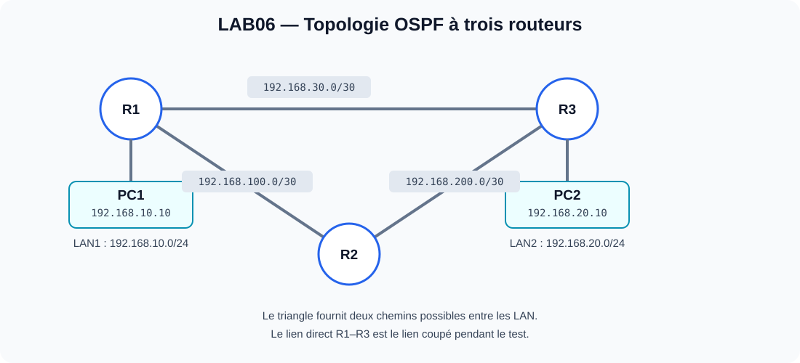
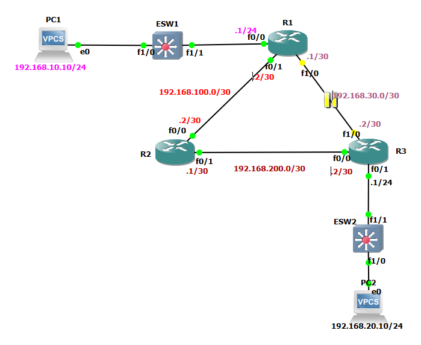
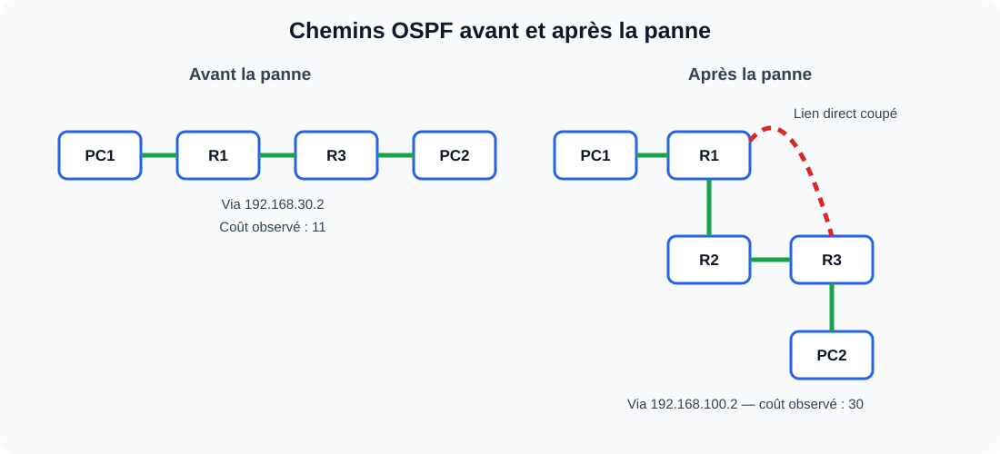
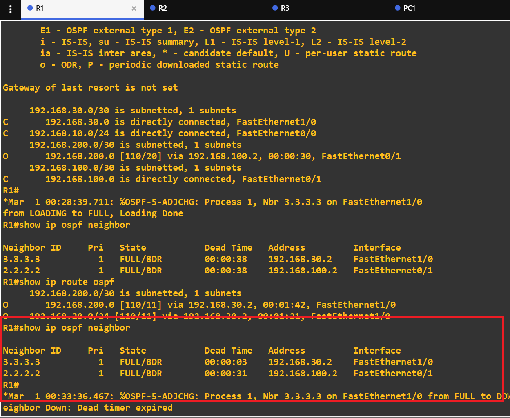
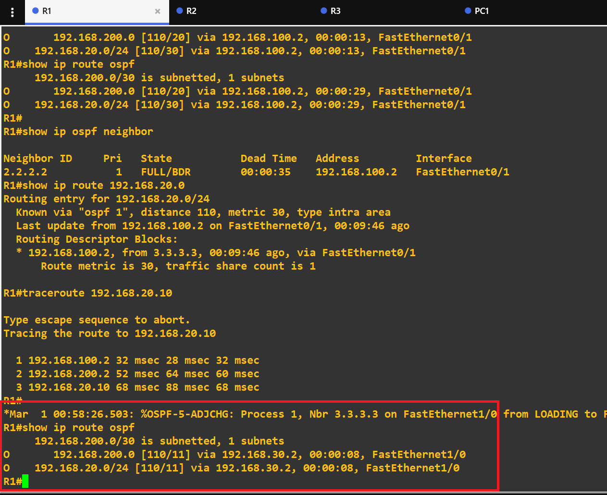
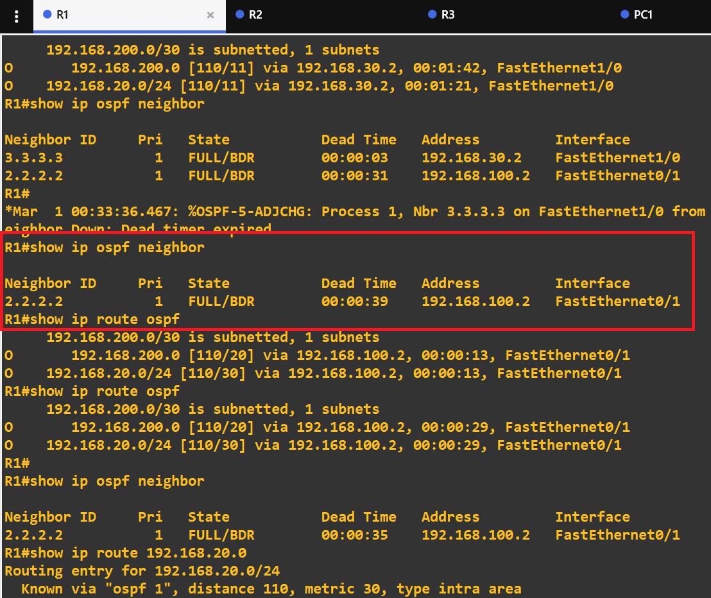
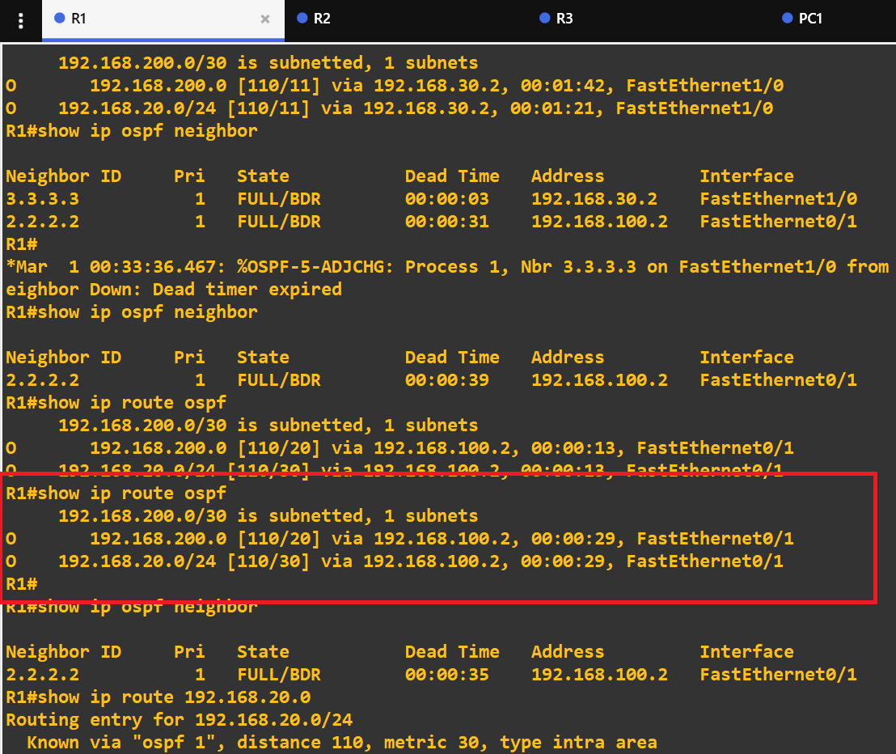
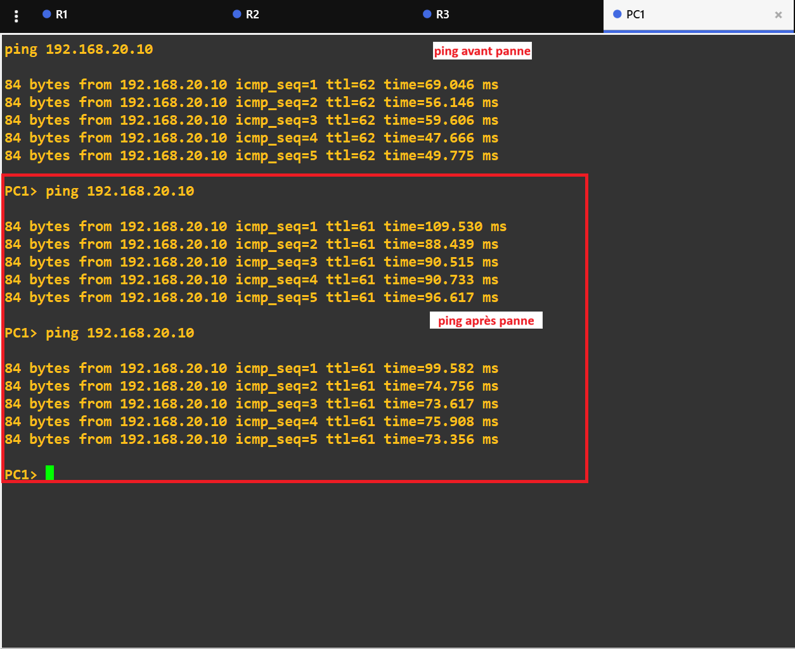
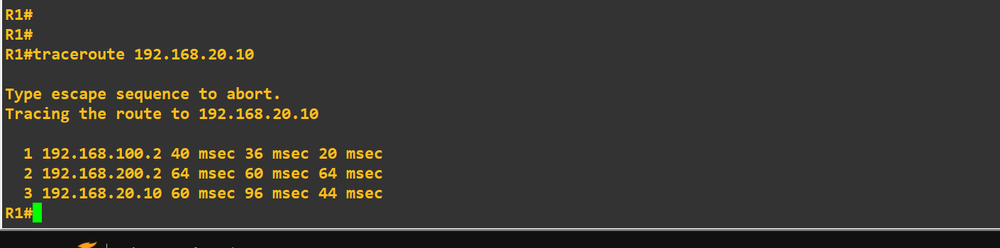

# LAB06 — OSPF : convergence et continuité de service après une panne



## Sommaire

1. [Présentation](#1-présentation)
2. [Objectifs](#2-objectifs)
3. [Topologie et plan d’adressage](#3-topologie-et-plan-dadressage)
4. [Configuration des postes VPCS](#4-configuration-des-postes-vpcs)
5. [Configuration OSPF](#5-configuration-ospf)
6. [Vérifications avant la panne](#6-vérifications-avant-la-panne)
7. [Simulation et détection de la panne](#7-simulation-et-détection-de-la-panne)
8. [Route après convergence](#8-route-après-convergence)
9. [Tests de connectivité](#9-tests-de-connectivité)
10. [Commandes de diagnostic](#10-commandes-de-diagnostic)
11. [Résultats et compétences acquises](#11-résultats-et-compétences-acquises)
12. [Arborescence du dépôt](#12-arborescence-du-dépôt)

---

## 1. Présentation

Ce laboratoire met en œuvre le protocole de routage dynamique **OSPFv2 (Open Shortest Path First)** dans une topologie composée de trois routeurs Cisco 2691, de deux réseaux locaux (LAN), de deux commutateurs Ethernet et de deux postes VPCS, simulés sous GNS3.

L’objectif est d’étudier le comportement d’OSPF lorsqu’une liaison directe entre R1 et R3 devient indisponible, puis de vérifier le rétablissement de la connectivité grâce à un chemin alternatif passant par R2.

La topologie en triangle offre deux chemins possibles entre les réseaux locaux :

- **Avant la panne :** PC1 → R1 → R3 → PC2.
- **Après la panne du lien R1–R3 :** PC1 → R1 → R2 → R3 → PC2.

Cette expérience permet d’observer la perte d’un voisinage OSPF, le recalcul de la route et le maintien de la connectivité entre les deux postes après convergence.

## 2. Objectifs

- Configurer OSPFv2 sur trois routeurs Cisco.
- Vérifier les voisinages OSPF et les routes apprises.
- Simuler l’interruption de la liaison directe R1–R3.
- Observer la détection de panne et la convergence du protocole.
- Comparer le prochain saut et le coût OSPF avant et après la panne.
- Vérifier la connectivité IP dans les deux sens.
- Utiliser les commandes de diagnostic pour analyser le comportement du réseau.
- Documenter les résultats à l’aide de captures d’écran et de configurations réseau.

## 3. Topologie et plan d’adressage

### 3.1. Topologie GNS3



*Figure 1 — Topologie de la maquette comprenant trois routeurs, deux commutateurs Ethernet, deux réseaux locaux et deux postes VPCS.*

La topologie comprend trois routeurs interconnectés en triangle. R1 et R3 disposent d’une liaison directe, tandis que R2 constitue un chemin alternatif entre ces deux équipements.

Les réseaux utilisés sont :

- LAN1 : `192.168.10.0/24`
- LAN2 : `192.168.20.0/24`
- Liaison R1–R2 : `192.168.100.0/30`
- Liaison R2–R3 : `192.168.200.0/30`
- Liaison directe R1–R3 : `192.168.30.0/30`

### 3.2. Tableau d’adressage IP

| Équipement | Interface | Adresse IP | Réseau / rôle |
|---|---|---|---|
| PC1 | Ethernet | `192.168.10.10/24` | Poste du LAN1 |
| R1 | FastEthernet0/0 | `192.168.10.1/24` | Passerelle LAN1 |
| R1 | FastEthernet0/1 | `192.168.100.1/30` | Liaison R1–R2 |
| R1 | FastEthernet1/0 | `192.168.30.1/30` | Liaison directe R1–R3 |
| R2 | FastEthernet0/0 | `192.168.100.2/30` | Liaison R2–R1 |
| R2 | FastEthernet0/1 | `192.168.200.1/30` | Liaison R2–R3 |
| R3 | FastEthernet0/0 | `192.168.200.2/30` | Liaison R3–R2 |
| R3 | FastEthernet0/1 | `192.168.20.1/24` | Passerelle LAN2 |
| R3 | FastEthernet1/0 | `192.168.30.2/30` | Liaison directe R3–R1 |
| PC2 | Ethernet | `192.168.20.10/24` | Poste du LAN2 |

**Remarque :** les noms d’interfaces correspondent au plan de référence du laboratoire. Vérifie-les avec `show ip interface brief` sur chaque routeur avant de publier les configurations définitives.

### 3.3. Chemins avant et après la panne



Avant la panne, le chemin direct R1–R3 est privilégié selon les coûts observés. Lorsque cette liaison devient indisponible, OSPF sélectionne le chemin alternatif passant par R2.

## 4. Configuration des postes VPCS

### 4.1. PC1

Adresse IP : `192.168.10.10/24`

Passerelle : `192.168.10.1`

```text
ip 192.168.10.10/24 192.168.10.1
save
```

### 4.2. PC2

Adresse IP : `192.168.20.10/24`

Passerelle : `192.168.20.1`

```text
ip 192.168.20.10/24 192.168.20.1
save
```

Les commandes `show ip` sur les VPCS permettent de vérifier l’adressage et la passerelle configurés.

## 5. Configuration OSPF

Les extraits ci-dessous présentent la configuration OSPF de référence du laboratoire. Ils doivent être comparés aux configurations réellement appliquées sur les routeurs.

### 5.1. Configuration de R1

```cisco
router ospf 1
 router-id 1.1.1.1
 network 192.168.10.0 0.0.0.255 area 0
 network 192.168.100.0 0.0.0.3 area 0
 network 192.168.30.0 0.0.0.3 area 0
 passive-interface FastEthernet0/0
```

### 5.2. Configuration de R2

```cisco
router ospf 1
 router-id 2.2.2.2
 network 192.168.100.0 0.0.0.3 area 0
 network 192.168.200.0 0.0.0.3 area 0
```

### 5.3. Configuration de R3

```cisco
router ospf 1
 router-id 3.3.3.3
 network 192.168.200.0 0.0.0.3 area 0
 network 192.168.20.0 0.0.0.255 area 0
 network 192.168.30.0 0.0.0.3 area 0
 passive-interface FastEthernet0/1
```

Les interfaces LAN sont configurées en passif dans OSPF afin d’annoncer les réseaux correspondants sans établir de voisinage OSPF avec les postes utilisateurs.

### 5.4. Enregistrement des configurations

Sur chaque routeur, après vérification de la configuration :

```cisco
end
write memory
```

Pour consulter la configuration active :

```cisco
show running-config
```

## 6. Vérifications avant la panne

Avant d’interrompre la liaison directe R1–R3, il faut vérifier l’état des interfaces, les voisinages OSPF et les routes apprises.

Commandes à exécuter sur les routeurs :

```cisco
show ip interface brief
show ip ospf neighbor
show ip route ospf
```

### 6.1. Vérification des voisinages OSPF



*Figure 2 — Voisinages OSPF sur R1 avant la panne.*

Les observations réalisées sur R1 avant la panne indiquaient les voisinages suivants :

| Router ID du voisin | Adresse du voisin | Interface locale | État rapporté |
|---|---|---|---|
| `3.3.3.3` (R3) | `192.168.30.2` | FastEthernet1/0 | FULL |
| `2.2.2.2` (R2) | `192.168.100.2` | FastEthernet0/1 | FULL |

L’état `FULL` indique que les bases de données de topologie OSPF des voisins sont synchronisées. Un suffixe comme `/DR` ou `/BDR` peut également apparaître selon le type de réseau et l’élection des routeurs désignés.

### 6.2. Route initiale vers le LAN2

Avant la panne, R1 utilisait la liaison directe vers R3 pour atteindre le réseau `192.168.20.0/24`.

La route observée était :

```text
O 192.168.20.0/24 [110/11] via 192.168.30.2, FastEthernet1/0
```

Interprétation :

- `O` : route apprise via OSPF.
- `110` : distance administrative d’OSPF.
- `11` : coût OSPF observé.
- `192.168.30.2` : adresse IP du prochain saut, correspondant à R3.
- `FastEthernet1/0` : interface de sortie de R1.



*Figure 3 — Route initiale vers le LAN2 via la liaison directe R1–R3.*

## 7. Simulation et détection de la panne

La liaison directe entre R1 et R3 a été interrompue dans GNS3 afin de provoquer la perte du voisinage OSPF correspondant.

La disparition de cette liaison oblige OSPF à recalculer les routes qui dépendaient du chemin direct.

### 7.1. Message de perte du voisinage

Le message suivant a été observé sur R1 :

```text
%OSPF-5-ADJCHG: Process 1, Nbr 3.3.3.3 on FastEthernet1/0
from FULL to DOWN, Neighbor Down: Dead timer expired
```

Ce message indique que le voisinage avec R3 est passé de l’état `FULL` à l’état `DOWN` après expiration du Dead timer.

La détection d’une panne n’est pas nécessairement instantanée. Le délai dépend du mécanisme de détection utilisé, de l’état de la liaison et des temporisateurs OSPF configurés.

Le voisinage avec R2 restant disponible, R1 peut utiliser le chemin alternatif via R2.



*Figure 4 — Message indiquant la perte du voisinage OSPF avec R3.*

## 8. Route après convergence

Après la perte du voisinage direct avec R3, R1 conserve son voisinage avec R2. OSPF recalcule alors la route vers le LAN2 en utilisant le chemin R1 → R2 → R3.

### 8.1. Nouvelle route vers le LAN2

La route observée après convergence était :

```text
O 192.168.20.0/24 [110/30] via 192.168.100.2, FastEthernet0/1
```

La commande suivante permet d’examiner la route spécifique :

```cisco
show ip route 192.168.20.0
```

Interprétation :

- Prochain saut : `192.168.100.2`, correspondant à R2.
- Interface de sortie : `FastEthernet0/1`.
- Distance administrative : `110`.
- Coût OSPF observé : `30`.



*Figure 5 — Nouvelle route vers le LAN2 via R2 après convergence.*

### 8.2. Comparaison avant et après la panne

| Indicateur | Avant la panne | Après convergence |
|---|---|---|
| Voisinage R1–R3 | FULL | Indisponible |
| Voisinage R1–R2 | FULL | Maintenu |
| Prochain saut vers LAN2 | `192.168.30.2` | `192.168.100.2` |
| Interface de sortie sur R1 | FastEthernet1/0 | FastEthernet0/1 |
| Coût OSPF observé | 11 | 30 |
| Chemin utilisé | R1 → R3 | R1 → R2 → R3 |

L’augmentation du coût et le changement de prochain saut confirment que la route alternative a été installée après convergence.

**Remarque :** si la liaison directe est rétablie, le voisinage R1–R3 peut revenir et la route directe peut redevenir préférable. Cet état doit être distingué de l’état stable observé pendant la panne.

## 9. Tests de connectivité

Des tests ICMP ont été effectués depuis PC1 vers PC2 avant et après la panne. Des tests dans le sens inverse ont également été rapportés.

### 9.1. PC1 vers PC2

Commande exécutée sur PC1 :

```text
ping 192.168.20.10
```

Résultats rapportés :

| Situation | Réponses reçues | TTL observé |
|---|---:|---:|
| Avant la panne | 5 sur 5 | 62 |
| Après la panne — test 1 | 5 sur 5 | 61 |
| Après la panne — test 2 | 5 sur 5 | 61 |

### 9.2. PC2 vers PC1

Commande exécutée sur PC2 :

```text
ping 192.168.10.10
```

Résultats rapportés :

| Situation | Réponses reçues | TTL observé |
|---|---:|---:|
| Avant la panne | 5 sur 5 | 62 |
| Après la panne — test 1 | 5 sur 5 | 61 |
| Après la panne — test 2 | 5 sur 5 | 61 |



*Figure 6 — Tests ICMP réalisés après convergence. Les deux postes continuent à communiquer à travers le chemin alternatif.*

Les tests dans les deux sens montrent que la connectivité entre les deux LAN a été maintenue après convergence.

La variation du TTL de 62 à 61 est cohérente avec un saut de routeur supplémentaire dans le chemin emprunté. Cependant, le TTL dépend aussi de sa valeur initiale et du système d’exploitation. Il ne suffit donc pas, à lui seul, à prouver le chemin emprunté. Les tables de routage et les résultats de traceroute apportent une confirmation complémentaire.

### 9.3. Vérification complémentaire par traceroute

Pour examiner le chemin réseau après convergence, exécuter depuis R1 :

```cisco
traceroute 192.168.20.10
```

Le chemin attendu, si la route alternative est active et si les équipements répondent aux sondes, est :

```text
1  192.168.100.2
2  192.168.200.2
3  192.168.20.10
```

Ces sauts correspondent à R2, R3 et à la destination PC2. Le résultat exact doit être confirmé par une capture réelle si cette vérification est incluse comme preuve dans le dépôt.



*Figure 7 — Chemin observé après convergence, à ajouter uniquement si le traceroute a effectivement été exécuté et capturé.*

## 10. Commandes de diagnostic

| Commande | Utilité |
|---|---|
| `show ip interface brief` | Vérifier l’état et l’adressage des interfaces |
| `show ip ospf neighbor` | Examiner les voisinages OSPF |
| `show ip route` | Consulter la table de routage complète |
| `show ip route ospf` | Examiner les routes apprises via OSPF |
| `show ip route 192.168.20.0` | Consulter la route vers le LAN2 |
| `show ip protocols` | Vérifier les paramètres des protocoles de routage |
| `show running-config` | Consulter la configuration active |
| `show logging` | Consulter les événements enregistrés |
| `ping <adresse>` | Tester la connectivité IP |
| `traceroute <adresse>` | Observer les sauts vers une destination |

Ces commandes permettent de vérifier l’état des interfaces, les voisinages, les routes sélectionnées et les événements associés à la panne.

## 11. Résultats et compétences acquises

Ce laboratoire a permis de mettre en pratique :

- la configuration d’OSPFv2 sur trois routeurs Cisco ;
- la vérification des voisinages et des routes dynamiques ;
- la simulation d’une panne de liaison dans GNS3 ;
- l’observation de la détection de panne et de la convergence ;
- l’analyse du changement de prochain saut et du coût OSPF ;
- la vérification de la connectivité avec ICMP ;
- l’utilisation de traceroute pour examiner le chemin réseau ;
- la documentation d’une maquette réseau à l’aide de captures d’écran.

### Conclusion

Après l’interruption de la liaison directe R1–R3, le voisinage OSPF correspondant a été perdu et la route vers le LAN2 a été recalculée via R2. Le prochain saut est passé de `192.168.30.2` à `192.168.100.2`, et le coût OSPF observé est passé de 11 à 30.

Les tests ICMP réalisés après convergence ont réussi, ce qui confirme le maintien de la connectivité entre PC1 et PC2 dans les conditions observées.

Ce laboratoire illustre la capacité d’OSPF à adapter dynamiquement le routage lorsqu’un chemin devient indisponible, à condition qu’un chemin alternatif existe et que la configuration des équipements soit correcte.

## 12. Arborescence du dépôt

```text
LAB06-OSPF-Convergence-Panne/
├── README.md
├── assets/
│   ├── topologie-ospf.svg
│   └── chemins-avant-apres.svg
├── captures/
│   ├── 01-topologie-gns3.png
│   ├── 02-voisinage-ospf-avant.png
│   ├── 03-routes-ospf-avant.png
│   ├── 04-panne-voisinage-down.png
│   ├── 05-routes-ospf-apres.png
│   ├── 06-pings-apres-panne.png
│   └── 07-traceroute-apres-panne.png
└── configs/
    ├── R1-running-config.txt
    ├── R2-running-config.txt
    └── R3-running-config.txt
```

### Remarques pour la publication

1. Place les captures réelles dans `captures/` en conservant exactement les noms référencés dans ce README.
2. Les fichiers `topologie-ospf.svg` et `chemins-avant-apres.svg` doivent être présents dans `assets/` pour que les diagrammes s’affichent sur GitHub.
3. Remplace ou complète les fichiers de configuration par les exports réels des routeurs si tu souhaites les publier.
4. N’ajoute pas de fausses captures : si un test n’a pas été exécuté, retire sa référence ou présente-le explicitement comme une vérification à effectuer.
5. Les résultats décrits correspondent aux observations rapportées pendant le laboratoire. Les captures et configurations publiées doivent permettre au lecteur de les vérifier.
